+++
title = "Cloth Houdini Digital Asset"
draft = false
projectgroup = "cfx"
+++

# Cloth Houdini Digital Asset



As part of my capstone film, Sandwich Kwon Do, I developed an HDA to run simulations on our antagonist's clothing. The goal was to make as clean and modular of an HDA as possible. The current HDA is able to simulate the bottoms of the character's pants, sleeve ends of his suit coat, and outputs a fully assembled preview that doubles as a deformation layer for stylistic clothing scribbles. Below is an overview of how the HDA functions and solutions that were implemented.

## HDA Overview
Below is a flow chart of the HDA and a screenshot of the network in Houdini:
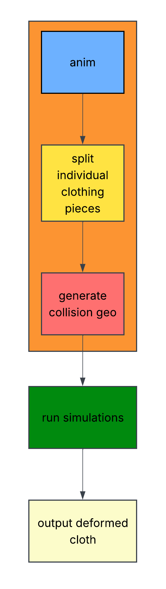

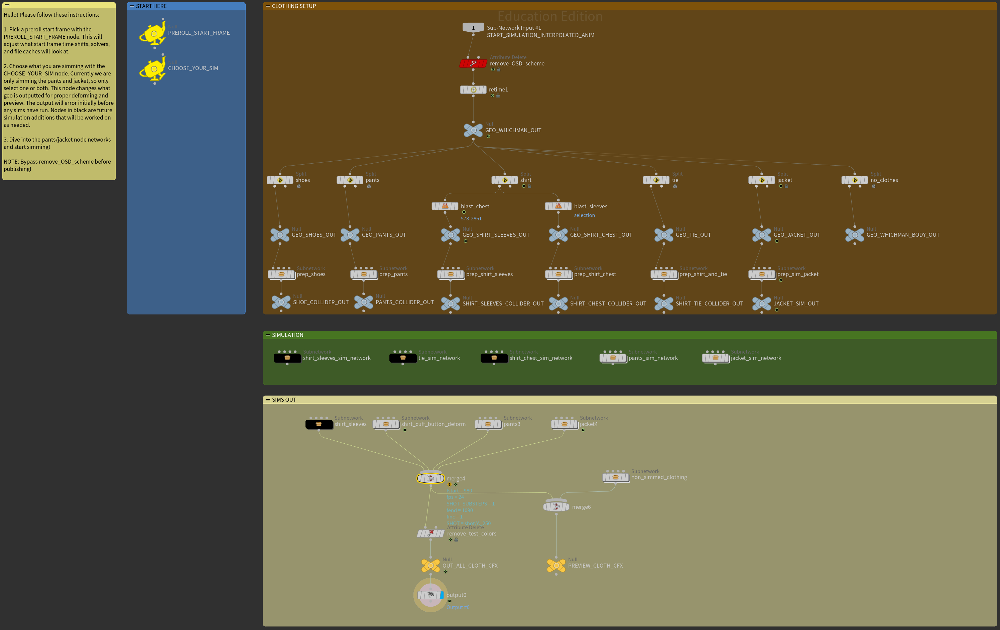

Upon diving into the HDA, artists will see 4 node network containers. The teapot nodes in the top left allow the artist to select where their preroll starts and what parts of the clothing they want to simulate. Current functionality supports jacket and pants with future plans to add other clothing items. These nodes automate two problems. The first is the need for setting preroll manually. This can be tedious when many file caches, solvers, or other time dependent nodes are involved.


  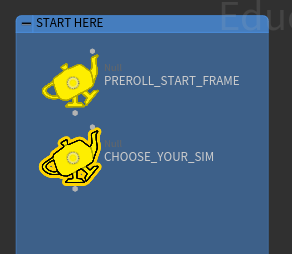
  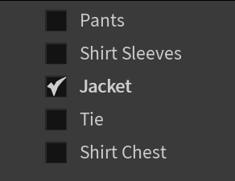
  


The second issue is the process of combining simmed with appropriate non-simmed clothing. For example, if just the jacket were simmed, the expected output would be the simmed jacket combined with non-simmed pants, shirt, etc. The checkbox interface takes care of this and produces the following preview. Each simmed piece of clothing a contrasting color for clarity:

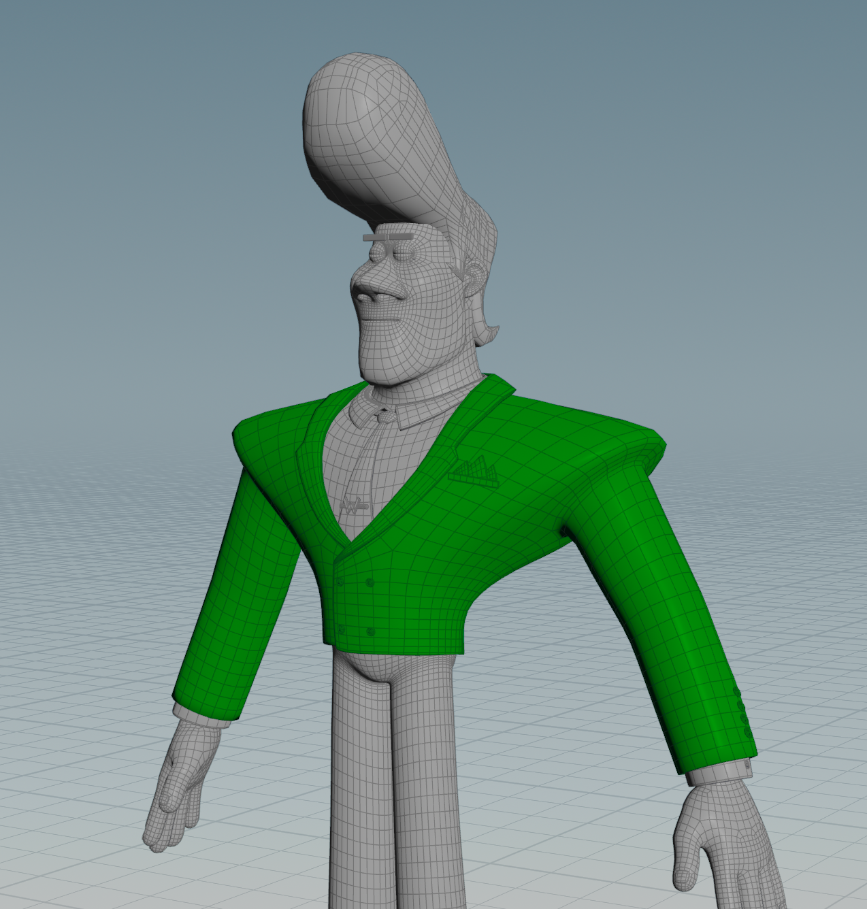

## Simulation Network


  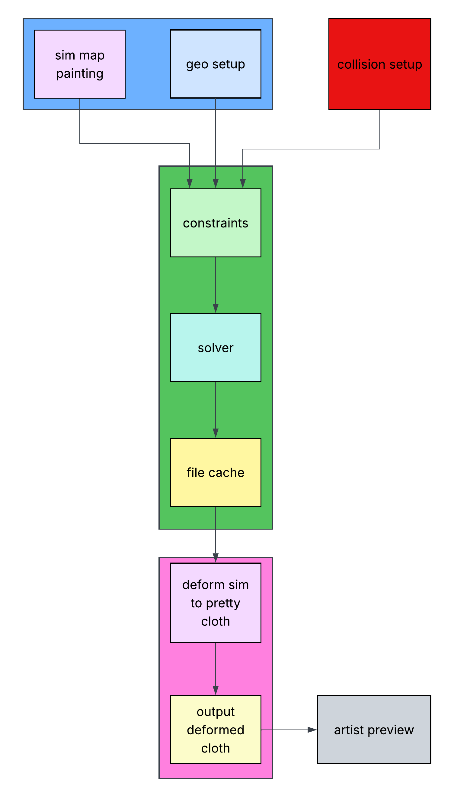
  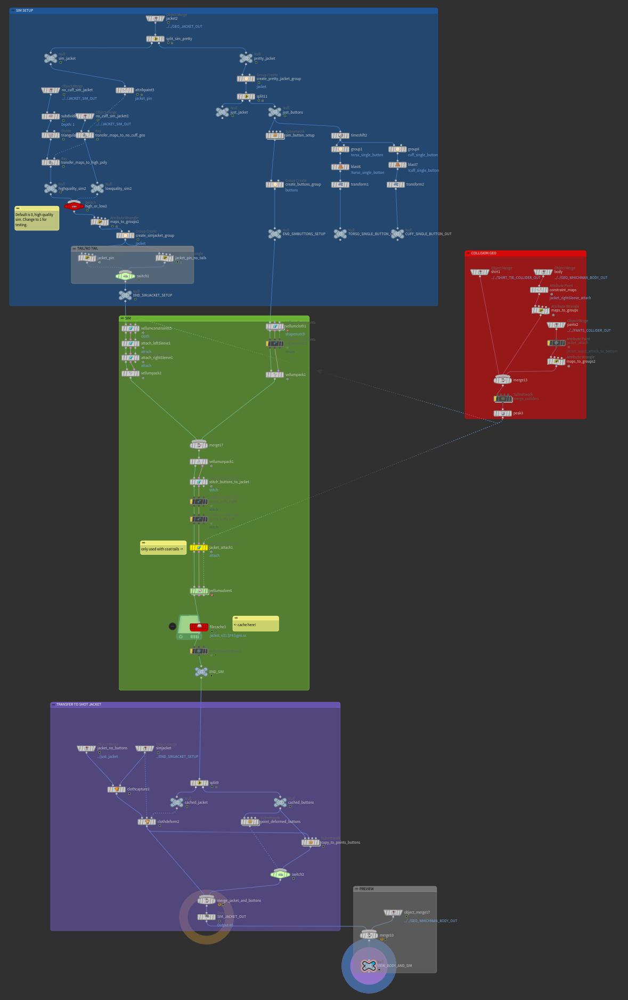


Each simulation subnet is broken in 4 areas:  
- Blue is for simulation setup with sim map painting and geo preparation.  
- Red brings in collisions.  
- Green houses all constrains and the vellum solver.  
- The final step, in purple, deforms the pretty cloth to proxy simulation geo. 

A unique challenge was retaining the rigidity of buttons. During animation the buttons deform with the cloth underneath, giving unnacceptable distortion to an otherwise rigid object:

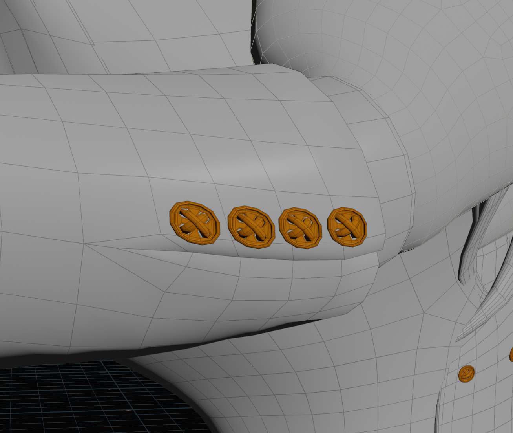

This was solved by creating a simulation proxy that was then vellum stitched to the clothing:


  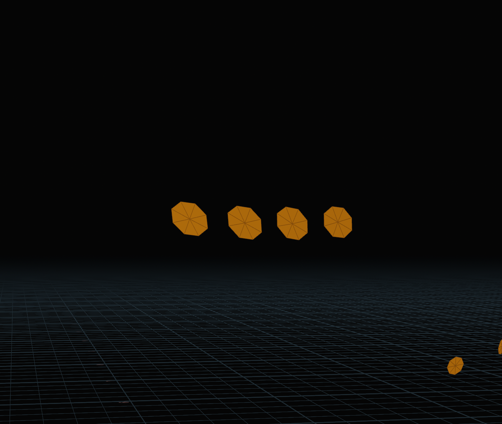
  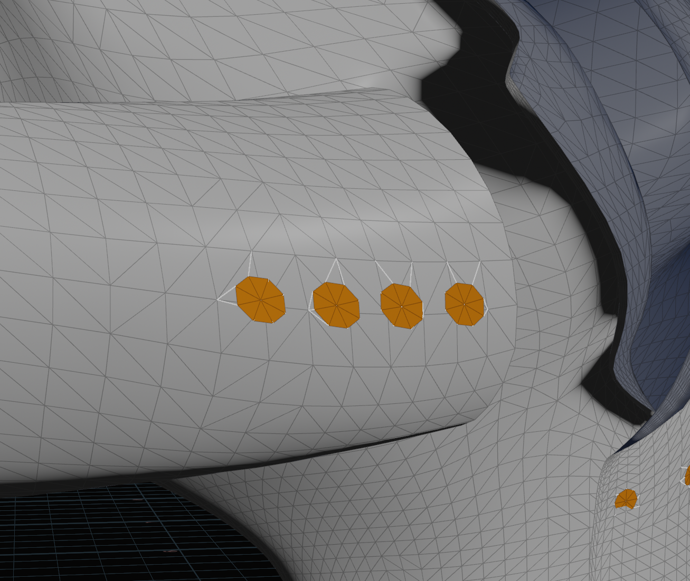


The buttons can organically follow the simulated cloth with this solution, but this introduced clipping issues. To solve this, I used Vex to offset the simulation buttons along the center normal:


  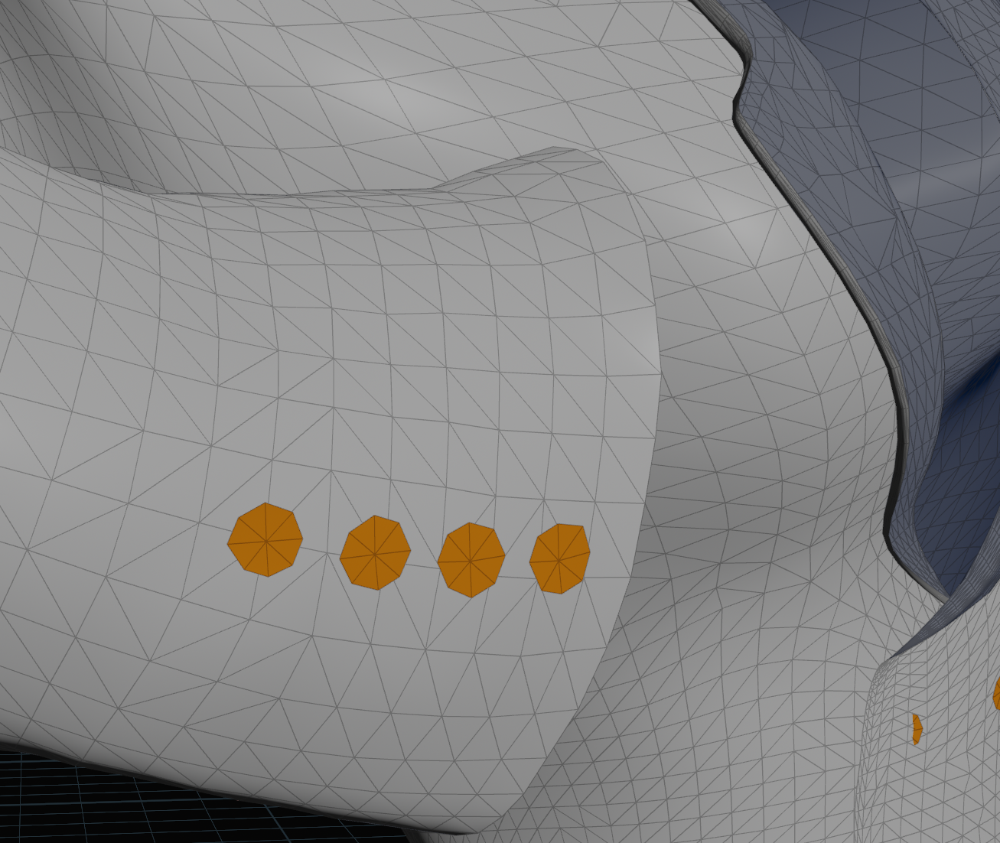
  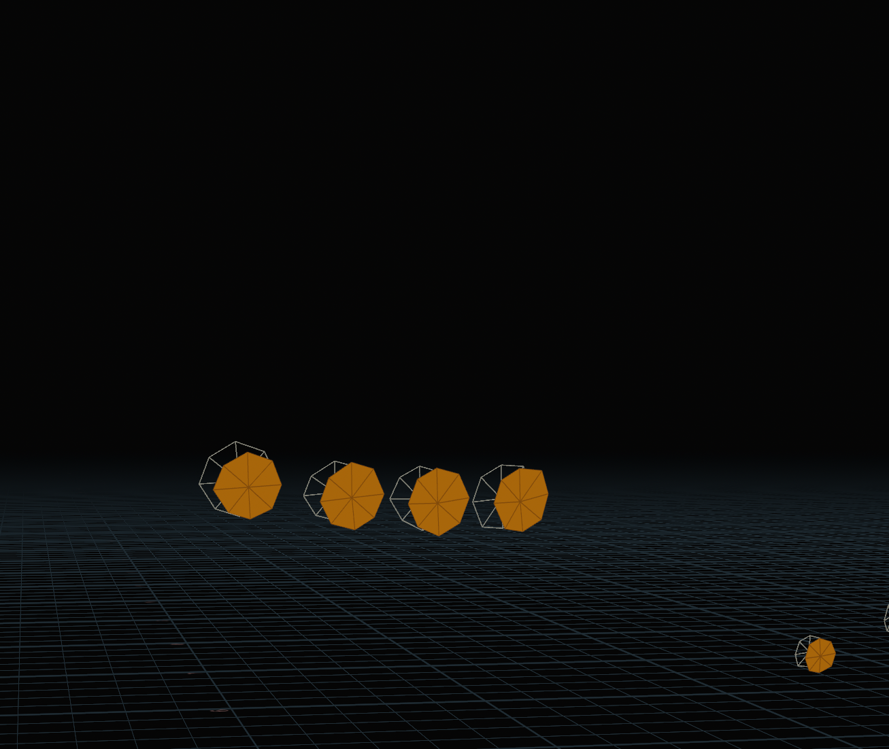


These buttons were then projected back onto the surface with the ray SOP. From there, non-deformed buttons were then populated in place of the proxy geo with copy to points:


  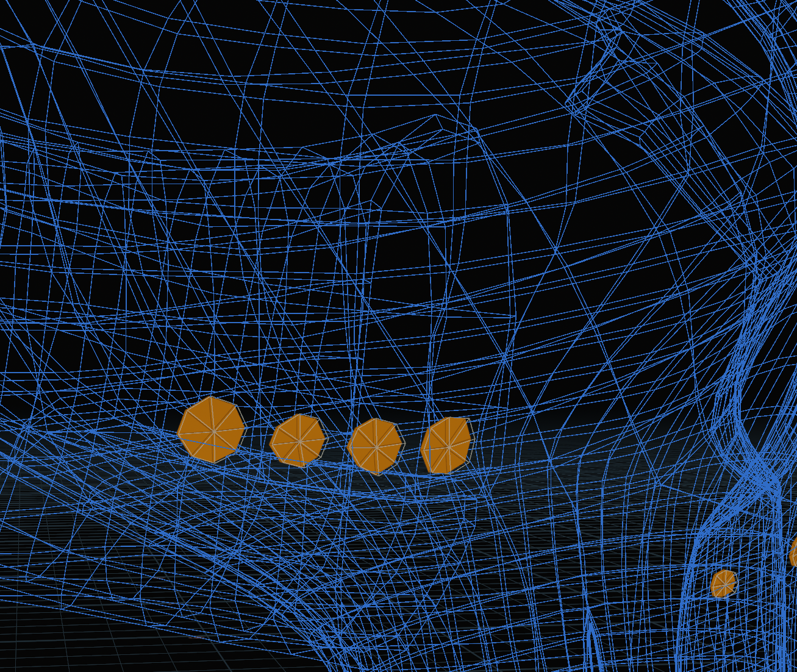
  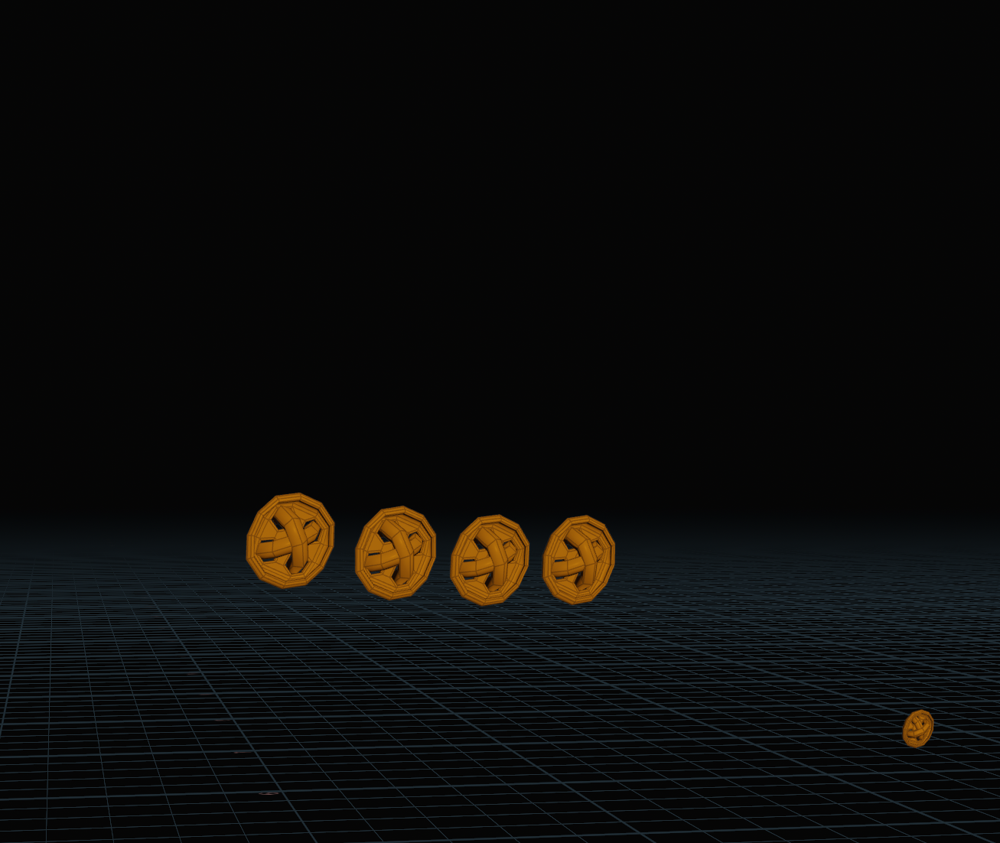


The result is a button that mantains a clean, rigid shape and true placement on the simulation geo.

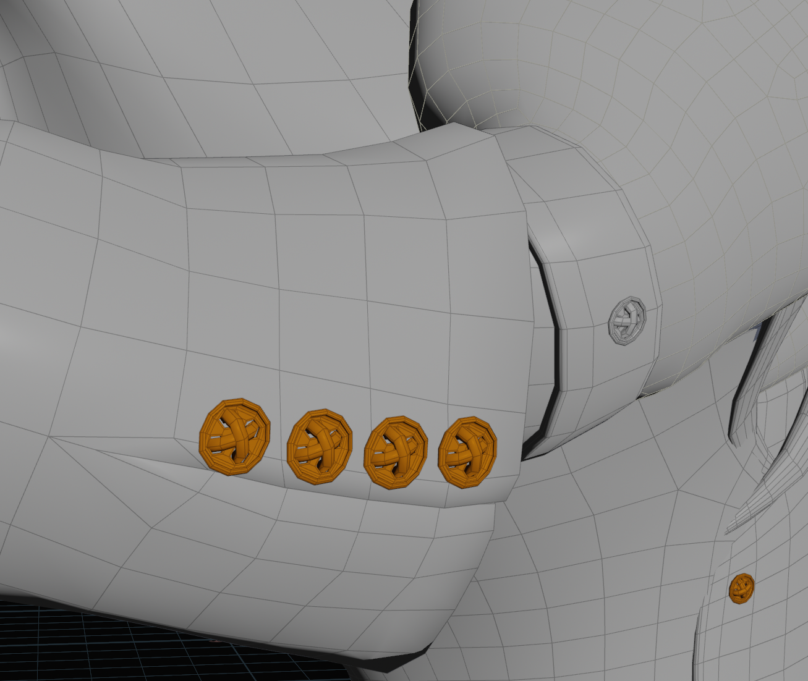

## Results
These solutions allow for an HDA that meets production needs and can adjust simulated items per shot at the click of a button.