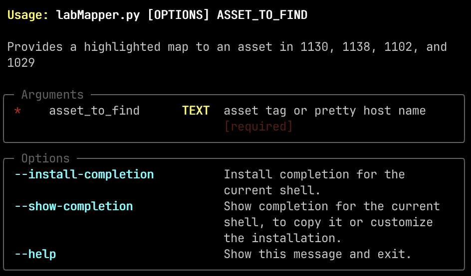
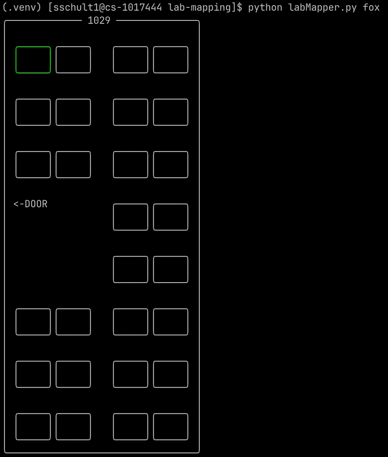

+++
date = '2026-11-24T10:27:56-07:00'
draft = false
title = ''
projectgroup = "code"
+++

# Lab Mapper

#### Source code: [](https://github.com/samuelSchulthies/labMapper)
 
At Brigham Young University our computer labs double as our render farm. With over 80 machines on the farm spread accross five labs, between three floors, it can be difficult and time consuming to locate a problem machine. Lab Mapper is a python CLI tool that solves this by printing a map to a machine of interest.  

Lab Mapper allows for a machine to be identified by its pretty host name or asset tag, then prints a map using the Python rich library. In the example below we run the script looking for the machine "fox." This prints out a map of room 1029 with the asset location blinking for easy visibility.

